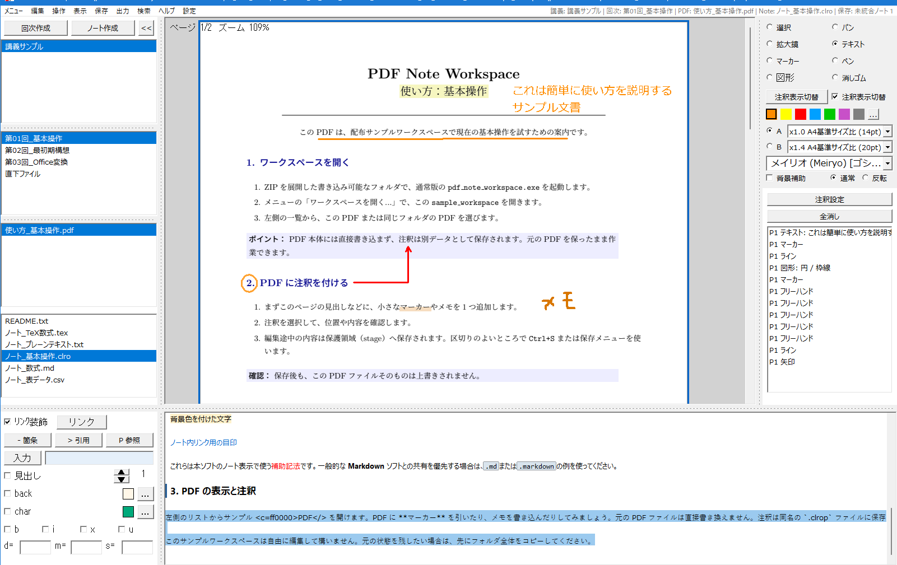

# PDF Note Workspace

[紹介サイト / Overview](https://pdf-note-workspace.soone-y.com/) · [詳細文書・使い方 / Documentation](https://soone-y.github.io/OPEN_PDF-Note-Workspace/) · [ダウンロード / Releases](https://github.com/soone-y/OPEN_PDF-Note-Workspace/releases)

PDFの表示・注釈の追加と、テキストファイルの編集ができるWindows用のオープンソースソフトです。PDFを表示したまま、同じ画面で授業のメモなどを入力できます。

An open-source Windows application for displaying PDFs, adding annotations, and editing text files. You can keep a PDF visible while typing lecture notes in the same window.

このソフトで「ノート」と呼ぶものは、`.clro`・`.md`・`.txt` などのテキストファイルです。入力した文章をファイルに保存します。

The application calls these text files "notes." They use extensions such as `.clro`, `.md`, and `.txt`, and contain the text you type.

[日本語の文書](https://soone-y.github.io/OPEN_PDF-Note-Workspace/docs/ja/README.html)（[GitHubで読む](https://github.com/soone-y/OPEN_PDF-Note-Workspace/blob/main/docs/ja/README.md)） · [English documentation](https://soone-y.github.io/OPEN_PDF-Note-Workspace/docs/en/README.html) ([Read on GitHub](https://github.com/soone-y/OPEN_PDF-Note-Workspace/blob/main/docs/en/README.md))

## できること / Features

- **PDFを表示しながらテキストを入力する** — PDFの表示欄とテキストの編集欄を同時に表示できます。PDFとメモ用のソフトを切り替える必要がありません。
- **PDFに注釈を付ける** — マーカー・下線、手書き、文字、図形、数式をPDFに重ねて表示します。線の座標や追加した文字などは、PDF本体とは別の `.clrop` ファイルへ保存します。
- **ファイルを一覧から開く・文字を検索する** — 授業・回次の一覧からPDFやテキストファイルを開けます。PDF本文、テキストファイル、文字で入力した注釈を検索できます。
- **PDFからテキストファイル内の位置へ移動する** — PDFに置いたリンクマーカーをクリックすると、対応するテキストファイル内の記述へ移動します。
- **PDF・PNG・テキストを出力する** — 注釈入りPDF、指定ページのPDF、1ページのPNGを作れます。開いているPDFの出力設定を複数予約し、一つのPDFへまとめることもできます。編集欄の文章はテキスト・Markdown・HTMLへ出力できます。
- **テキストの記法に従って書式を表示する** — `.clro` と `.md` は、Markdownの見出し・箇条書き・表や、文字色・下線などの独自記法を解釈して表示します。`.clro` の中身はUTF-8テキストです。`.txt` は記法を解釈せず、そのまま表示・編集します。

- **Type text while viewing a PDF** — Display the PDF pane and text editor at the same time, without switching between a PDF viewer and a separate text editor.
- **Add PDF annotations** — Display highlights, underlines, handwriting, text, shapes, and math over the PDF. Stroke coordinates, added text, and other annotation data are saved in a separate `.clrop` file.
- **Open files from lists and search their text** — Select PDFs and text files from course and session lists. Search PDF text, text files, and typed annotations.
- **Jump from the PDF to a position in a text file** — Click a link marker on the PDF to open the corresponding passage in a text file.
- **Export PDFs, PNGs, and text** — Create annotated PDFs, selected-page PDFs, and single-page PNGs. Queue multiple output settings for the open PDF and combine them into one PDF. Export the editor's text as text, Markdown, or HTML.
- **Display formatting from text markup** — `.clro` and `.md` support Markdown headings, lists, and tables, plus additional markup for text color and underlining. A `.clro` file contains UTF-8 text. `.txt` files are displayed and edited without interpreting markup.

## ファイルと保存 / Files and saving

PDF本体、注釈のデータ、入力した文章は、別々のファイルに保存します。

The PDF, annotation data, and text you type are stored in separate files.

| ファイル / File | 保存する内容 / Contents |
| --- | --- |
| `.pdf` | 元の資料。注釈作業では本文や画像を直接書き換えません。 / Original material; annotation work does not directly rewrite its text or images. |
| `.clrop` | 線の座標・色、追加した文字などを記録するJSONファイル。PDFと同じフォルダーに、拡張子を除いて同じ名前で保存します。 / JSON containing stroke coordinates, colors, added text, and other annotation data; saved alongside the PDF with the same base name. |
| `.clro` / `.md` / `.txt` など / and others | 編集欄へ入力した文章を保存するテキストファイル。PDFとは別に開いて編集できます。 / Text files containing the text entered in the editor; they can be opened and edited separately from the PDF. |

`Ctrl+S` で、入力した文章をテキストファイルへ、追加した注釈を `.clrop` へ保存します。PDF本体は書き換えません。PDFと `.clrop` は組でコピー・移動してください。

`Ctrl+S` saves typed text to the text file and annotations to `.clrop`, without changing the PDF itself. Copy or move each PDF together with its `.clrop`.

注釈付きのPDFを他の人へ渡すときは、PDF出力を使います。元のPDFからページをコピーし、`.clrop` の注釈を追加した別のPDFを作ります。メインソフトでは、注釈を本文と一体化する「焼き込み」ではなく、標準PDF注釈として追加します。出力後に他のソフトで編集できる範囲は、ソフトと注釈の種類によります。

To send an annotated PDF to someone else, use PDF export. It copies pages from the original PDF and adds the `.clrop` annotations to a new PDF. The main app adds standard PDF annotations instead of flattening them into the page content. What another application can edit depends on that application and the annotation type.

編集中の文章や注釈は、保存先のファイルとは別に自動で一時保存します。通常の保存では、上書き前にバックアップを作ります。保存・復元の操作は各言語の文書を参照してください。

During editing, the app automatically saves text and annotation changes to temporary files instead of overwriting their destination files. Normal saving creates a backup before overwriting an existing file. See the documentation in your language for saving and recovery instructions.

アプリに外部通信機能はありません。PDFの表示と注釈の追加、テキストファイルの編集、Office文書のPDF変換はPC内で行います。

The application has no external communication features. PDF viewing and annotation, text-file editing, and Office-to-PDF conversion run on your PC.

### 保存場所を自分で管理する / Keep data in locations you control

配布 ZIP は展開して使います。設定は展開後のアプリフォルダー、作業データは利用者が選んだワークスペース、出力は利用者が選んだ保存先で管理します。保存先の範囲と「一時パス」の扱いは、[日本語のセットアップ文書](docs/ja/Getting_Started.md)／[English setup guide](docs/en/Getting_Started.md) を参照してください。

Use the distributed ZIP by extracting it. Application settings stay in the extracted application folder, work data in the workspace you choose, and output at destinations you choose. For storage boundaries and temporary paths, see the [Japanese setup guide](docs/ja/Getting_Started.md) or [English setup guide](docs/en/Getting_Started.md).

## 入手方法 / Download

対応環境は **Windows x64（64-bit）** です。macOSおよび32-bit Windows向けの配布物はありません。

Packages are for **Windows x64 (64-bit)**. No macOS or 32-bit Windows packages are provided.

[GitHub Releases](https://github.com/soone-y/OPEN_PDF-Note-Workspace/releases) の **Assets** から、利用する言語と版に合うZIPを一つ取得してください。`Source code (zip)` / `Source code (tar.gz)` はアプリの配布物ではありません。

Choose one ZIP matching your language and edition from the release **Assets**. The automatically generated `Source code (zip)` / `Source code (tar.gz)` archives are not application packages.

| 言語・版 / Language and edition | ファイル名の目安 / Asset name pattern |
| --- | --- |
| 日本語・通常版 / Japanese Full | `pdf_note_workspace_<version>_ja_full.zip` |
| 日本語・軽量版 / Japanese Lite | `pdf_note_workspace_<version>_ja_lite.zip` |
| English Full | `pdf_note_workspace_<version>_en_full.zip` |
| English Lite | `pdf_note_workspace_<version>_en_lite.zip` |

**通常版 / Full:** `.docx` や `.pptx` をアプリ内でPDFに変換して使いたい場合に選びます。同梱のLibreOfficeでローカル変換し、Microsoft Officeやオンライン変換サービスは使いません。変換結果は確認して使ってください。

Choose Full to convert Office documents such as `.docx` and `.pptx` to PDF inside the app. Conversion uses bundled LibreOffice locally, not Microsoft Office or an online service. Check the converted result before use.

**Lite版 / Lite:** 既にPDFを持っている場合や、小さい配布物を使いたい場合に選びます。PDFの表示・注釈、テキストファイルの編集ができ、Office-to-PDF変換は含みません。

Choose Lite if you already have PDFs or want a smaller package. It includes PDF viewing, annotation, and text-file editing without Office-to-PDF conversion.

### 更新 / Updates

アプリは、新しい版の確認、ダウンロード、インストールを自動では行いません。更新する場合は、利用者自身で [GitHub Releases](https://github.com/soone-y/OPEN_PDF-Note-Workspace/releases) を開き、新しい ZIP を入手して別の新規フォルダーへ展開します。起動を確認してから、必要に応じて新しい版へ移行してください。

The application does not automatically check for, download, or install updates. To update, open [GitHub Releases](https://github.com/soone-y/OPEN_PDF-Note-Workspace/releases), download a new ZIP yourself, and extract it into a separate new folder. Confirm that it starts before moving to the new version as needed.

## 使い始める / Get started

1. ZIP全体を、書き込み可能な新しいフォルダーへ展開します。ZIP内から直接起動せず、EXE・DLL・設定などの配布物を分けて移動しないでください。

   Extract the entire ZIP into a new writable folder. Do not run it inside the ZIP or separate the EXE, DLLs, and configuration files.
2. 展開先の `pdf_note_workspace.exe` を起動します。インストーラーやアカウント登録は不要です。

   Run `pdf_note_workspace.exe` from the extracted folder. No installer or account registration is required.
3. 同梱の `sample_workspace` にあるPDFと `.clro` を開き、表示や入力を確認します。自分の資料を使うときは、作業用のフォルダーを選びます。画面の「授業」「回次」の一覧は、そのフォルダー内の授業別・回次別フォルダーに対応します。

   Open the PDF and `.clro` files in the bundled `sample_workspace` to check viewing and typing. For your own files, select a working folder. The course and session lists correspond to course and session subfolders inside it.

## 閲覧だけしたいとき / Read-only viewer

通常版・Lite版とも `readonly_viewer.exe` を同梱しています。PDFやテキストファイルを複数のタブで開けます。同じフォルダーに、拡張子を除いてPDFと同じ名前の `.clrop` があれば、PDFに注釈を重ねて表示します。注釈の追加やテキストの編集には `pdf_note_workspace.exe` を使います。

Both editions include `readonly_viewer.exe`, which opens PDFs and text files in multiple tabs. If a `.clrop` with the same base name is in the PDF's folder, the viewer displays its annotations over the PDF. Use `pdf_note_workspace.exe` to add annotations or edit text.

## 文書 / Documentation

- 文書全体の入口 / Documentation map: [DOCUMENTATION.md](DOCUMENTATION.md)
- 固定入力による規模・配布容量・検証範囲 / Source scale, distribution sizes and verification scope: [STATISTICS.md](STATISTICS.md)
- 日本語: [docs/ja/README.md](docs/ja/README.md) — セットアップ、基本操作、保存と復元、ファイル形式、ノート記法、閲覧専用ソフト、トラブル対処、ビルド方法。
- English: [docs/en/README.md](docs/en/README.md) — Setup, everyday use, saving and recovery, file formats, note syntax, the read-only viewer, troubleshooting, and building from source.

不具合の報告や対応状況は [Issues](https://github.com/soone-y/OPEN_PDF-Note-Workspace/issues) を参照してください。

Use [Issues](https://github.com/soone-y/OPEN_PDF-Note-Workspace/issues) for bug reports and their status.

## ライセンス / License

The project license is the zlib License. The English text is the legally controlling text.

本プロジェクトのライセンスは zlib License です。英語原文が法的な正本です。

- 日英併記のライセンス情報: [LICENSE.md](LICENSE.md)
- Third-party notices: [THIRD_PARTY_NOTICES.md](THIRD_PARTY_NOTICES.md)

各 Release には、同じ言語のアプリ、文書、sample workspace、ライセンス文書、第三者通知を含めます。

Each release package includes the app, documentation, sample workspace, license documents, and third-party notices for the selected language.

---

## 実行時の依存物とファイル配置 / Runtime dependencies and files

Windows x64配布物で使うファイルを示します。以下のDLLは、使うEXEと同じフォルダーに置きます。通常版・Lite版、日本語版・英語版でDLL名は共通です。異なる配布物のEXEやDLLを混ぜないでください。

This section describes the files in the Windows x64 packages. Keep the following DLLs in the same folder as the EXE that uses them. DLL names are shared across Full/Lite and Japanese/English packages. Do not mix EXEs or DLLs from different packages.

### 起動時に読み込むDLL / DLLs loaded at startup

| ファイル / File | メイン / `pdf_note_workspace.exe` | 閲覧専用 / `readonly_viewer.exe` | 用途 / Purpose |
| --- | --- | --- | --- |
| `pdfium.dll` | 必要 / Required | 必要 / Required | PDFium。PDFの読込・表示・出力。 / PDF loading, rendering, and output. |
| `libstdc++-6.dll` | 必要 / Required | 必要 / Required | C++標準ライブラリ。 / C++ standard library. |
| `libgcc_s_seh-1.dll` | 必要 / Required | 必要 / Required | GCCの実行時処理・例外処理。 / GCC runtime and exception handling. |
| `libwinpthread-1.dll` | 必要 / Required | 必要 / Required | スレッド・同期処理。 / Threading and synchronization. |
| `zlib1.dll` | 必要（Lite版も） / Required, including Lite | 不要 / Not required | zlib。圧縮データの処理。 / Compressed-data processing. |

これらは起動時に読み込むため、PDFを開かない場合でも必要です。閲覧専用ソフトはメインソフトのEXEを使わずに起動できますが、表の4つのDLLは必要です。この表は起動用DLLの区別であり、ほかの同梱ファイルを削除するための一覧ではありません。

These DLLs are loaded at startup even when no PDF is opened. The read-only viewer can start without the main EXE, but still needs its four DLLs listed above. This table identifies startup DLL dependencies; it is not a list of files to keep while deleting the rest of the package.

Windows標準のDLLとUCRTはOS側から読み込みます。閲覧専用ソフトの書式付き文字表示には、Windowsの `Msftedit.dll`（RichEdit）を使います。OSのDLLを配布フォルダーへコピーする必要はありません。Markdown解析用のMD4Cは両EXEに組み込み済みで、別の `md4c.dll` は使いません。

Windows system DLLs and the Universal C Runtime (UCRT) are loaded from the OS. The viewer uses Windows `Msftedit.dll` (RichEdit) for formatted text display; do not copy system DLLs into the package. The MD4C Markdown parser is compiled into both EXEs, with no separate `md4c.dll`.

### 特定の機能で使う同梱ファイル / Files used by specific features

| ファイル・フォルダー / File or folder | 使用箇所 / Used by |
| --- | --- |
| `lo/` | 通常版のメインソフトがOffice文書をPDFへ変換するときに使うLibreOffice一式。入口は `lo/program/soffice.com`。その1ファイルだけでなく、`lo/` 内のDLL・設定・共有データも必要です。Lite版には含めず、閲覧専用ソフトは使用しません。 / Full-edition Office conversion runtime, entered through `lo/program/soffice.com`. Keep the entire `lo/` tree, including its DLLs, configuration, and shared data. Not included in Lite or used by the read-only viewer. |
| `libreoffice/image/Fonts/` | メインソフトが読み込む同梱フォント。Lite版にも含まれます。Office変換本体の `lo/` とは別のフォルダーです。 / Bundled fonts loaded by the main app, including Lite. Separate from the `lo/` conversion runtime. |
| `docs/`、`LICENSE.md`、`licenses/` | 操作説明、プロジェクトと依存物のライセンス文書。起動用DLLではありませんが、説明やライセンスの閲覧・再配布のために配布物と一緒に保管します。 / User guides and project/component licenses. Not startup DLLs, but keep them with the package for reading the documentation, checking licenses, and redistribution. |

### 設定と作業ファイル / Configuration and working files

| ファイル・フォルダー / File or folder | 内容・配置 / Contents and location |
| --- | --- |
| `pdf_note_workspace_setup.json` | EXEと同じフォルダーにある配布用設定。メインソフトで開く作業フォルダーなどの参照先を記録します。閲覧専用ソフトも共通の閲覧状態を読む場合に参照します。 / Distributed configuration beside the EXEs, recording the main app's working-folder location and other references. The viewer also reads it when restoring shared viewing state. |
| `readonly_setup.json` | 閲覧専用ソフトの設定・閲覧状態を保存するファイル。保存の操作や設定に応じて、EXEと同じフォルダーへ作成・更新します。DLLとは異なり、配布時から必ず存在するファイルではありません。 / Viewer preferences and session state, created or updated beside the EXE according to save operations and settings. Unlike a startup DLL, it need not exist in a fresh package. |
| `__pdf_note_workspace__/` | 利用者が選んだ作業フォルダー内の管理データ。編集中の一時保存やバックアップなどを置きます。アプリの動作中は、このフォルダーや中のファイルを削除しないでください。 / Managed data inside the selected working folder, including editing checkpoints and backups. Do not delete this folder or its contents while the app is running. |

削除する場合は、この作業フォルダーを使うアプリをすべて終了してください。終了後に削除された管理フォルダーは、次回利用時に書き込み可能であれば再作成します。削除されたバックアップや未保存の変更を復元するには、復元用データが必要です。

Before deleting managed data, close all app instances using that working folder. Missing management folders are recreated when next needed if the location is writable. Recovering deleted backups or unsaved changes requires surviving recovery data.

PDF・`.clrop`・文章を保存するテキストファイルは、上記の実行用DLLや設定とは別の利用者ファイルです。EXEのあるフォルダーは設定の作成・更新に書き込み権限が必要です。作業フォルダーや出力先も、保存する場所を書き込み可能にしてください。

PDFs, `.clrop` annotation files, and the text files you edit are user files, separate from the runtime DLLs and settings above. The EXE folder must be writable to create or update settings. Working folders and output destinations must also be writable when saving there.

配布ZIPを実行するだけなら、C++コンパイラ、PDFiumのヘッダーやimport libraryは不要です。これらはソースコードからビルドするときに使います。配布物の部品を分けず、展開したフォルダー全体を保管してください。

Running the distributed ZIP does not require a C++ compiler, PDFium headers, or an import library; those are build-time inputs. Keep the extracted package folder intact.
