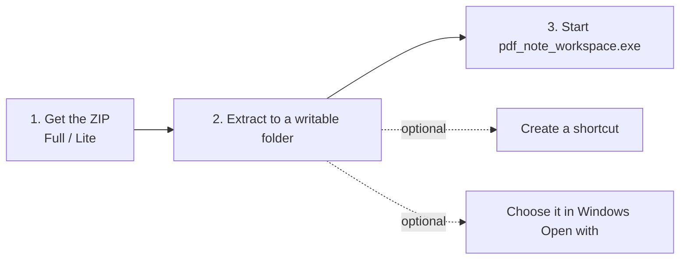

# Setup, Updates, and Uninstall

This application has no installer. You use it by extracting the ZIP. It needs no administrator rights or network connection, and it never changes default apps by itself.

This package is for **Windows x64 (64-bit)**. No package is provided for 32-bit Windows.



## 0. Get the package from GitHub

You need no GitHub account or Git knowledge. Open the repository's **Releases** page (or the latest release in the **Releases** area on the right), and download one ZIP for the edition you want from **Assets**. If the page looks different, open the latest release from the **Releases** list and expand **Assets**.

`Source code (zip)` and `Source code (tar.gz)` are source code for development. They are not the ZIP for using the application, so do not choose them.

## 1. Choose Full or Lite

Extract either the Full ZIP or the Lite ZIP. Do not mix the two distribution folders, and do not move only the DLLs or the Office-conversion runtime folder from one into the other.

| Edition | Choose it when | Office files |
| --- | --- | --- |
| Full | You want to turn `.docx` / `.pptx` files into PDFs inside the app | Converted locally with the bundled LibreOffice. Always check the converted result |
| Lite | You already have PDFs, or you want a smaller package | No Office-to-PDF conversion. Import PDFs that you have already converted |

PDF viewing, annotations, notes, saving, and recovery work the same way in both editions. Lite shows `Lite` in its window title after it starts. Neither edition uses Microsoft Office or an online conversion service.

The first LibreOffice conversion in Full can take longer to start while Windows performs a security check. Conversion runs in the background, so the main app remains usable. Canceling a conversion, closing the app, or a Windows end-session request also stops the LibreOffice conversion processes. Originals are not changed.

## 2. Extract the package

1. Right-click the ZIP file and choose **Extract All**.
2. We recommend a new writable folder directly under your user profile or Documents. If Windows reports that a target path is too long, you can instead try a short drive-root folder such as `C:\PDFNote`. Avoid deeply nested folders or very long folder names, which can prevent Windows from extracting the Office-conversion runtime.
3. The application does not start while you are browsing inside the ZIP. Start `pdf_note_workspace.exe` from the extracted folder.

Normally you use `pdf_note_workspace.exe`. Use `readonly_viewer.exe` when you only need to view files.

::: details If “Windows protected your PC” appears on first start

The first time you start `pdf_note_workspace.exe` or `readonly_viewer.exe`, a blue Microsoft Defender SmartScreen screen may say “Windows protected your PC”. At first it seems to offer only **Don't run**, but you can start the application as follows.

1. Click **More info** (the underlined link) in the message.
2. A **Run anyway** button appears at the bottom right. Click **Run anyway**.

Windows shows this screen because the ZIP package has no code signature. The application performs no external communication or dangerous processing. After you allow it once, it starts without this screen.

:::

::: details Why the contents of the distribution folder stay together

Besides the executables, the distribution folder contains the parts the application needs to run: `pdfium.dll` for PDF display, the C++ runtime DLLs, and, in Full, the LibreOffice runtime for Office conversion. Windows normally loads DLLs relative to the folder of the executable, so moving the EXEs and DLLs into different folders can make starting or PDF display fail. Lite has no LibreOffice runtime by design.

Full keeps the conversion runtime in `lo/` and the bundled fonts in `lo/image/Fonts/`. Lite keeps only the fonts in `libreoffice/image/Fonts/`, so its folder layout differs slightly. Keep each edition's supplied layout.

LibreOffice has deeply nested internal folders, so Full groups its related files under the short `lo/` name to reduce Windows extraction-path length problems. Lite has no conversion runtime and uses `libreoffice/` to identify the source of its bundled fonts.

`pdf_note_workspace_setup.json` is the distribution setting that records the workspace and the temporary external paths used at startup. It is read relative to the folder of the executable, so do not move or rename it either. A legacy `pdf_workspace_setup.json` is safely copied to the new name on first start; the legacy file is not removed. Keep your own PDFs, notes, annotations, and other work data in a workspace separate from the distribution folder.

To organize files, place the whole distribution folder somewhere easy to find and start it from a shortcut, instead of sorting its contents into other folders. A shortcut does not copy the package; it starts the EXE in the original folder, which keeps the DLLs and setting files where they belong.

:::

### Choose where your data is kept

Use the distributed ZIP by extracting it. Persistent files are kept in the following locations.

| Location | What is kept there |
| --- | --- |
| Extracted application folder | EXEs, DLLs, and setup files such as `pdf_note_workspace_setup.json` and `readonly_setup.json` |
| Workspace you choose | PDFs, notes, and `.clrop` files. `__pdf_note_workspace__` holds automatic work protection, backups, workspace settings, themes and memo, lectures and sessions deleted in the app, logs, temporary Office-conversion data, and more. |
| Output destination you choose / external folder registered as a temporary path | Files that you explicitly save, export, or use for external work |

The application does not use AppData, the Windows temporary folder, or the launch working directory as an implicit storage location. If it cannot write to a location you chose, it reports the failure instead of saving automatically somewhere else. This describes persistent file storage, not the memory used while the application is running.

To use an existing external folder without copying it, choose **File > Temporary Paths > Add external folder**. Registration follows an access check and persists after restart; “temporary” does not mean the Windows temporary directory. Saving, renaming and moving affect the actual registered files, while removing the registration leaves originals intact. [Retry unsaved settings](Save_and_Recovery.md#retry-unsaved-settings) explains where to review a failed registration and how to retry it.

## 3. Create shortcuts (optional)

### Desktop

Right-click `pdf_note_workspace.exe` and choose **Create shortcut**. If Windows asks where to create it, choose **Yes** to place it on the desktop.

If the shortcut is created in the distribution folder, move the shortcut to the desktop. Do not move `pdf_note_workspace.exe` itself, or the DLLs and `pdf_note_workspace_setup.json` in the same folder.

### Start menu

Right-click the shortcut you created and choose **Pin to Start**. If Windows does not show that item, look under **Show more options**.

## 4. Choose the app for opening .clro / .clrop / PDF files (optional)

You choose file associations yourself in Windows. The application never changes default apps by itself.

1. Right-click the file and open **Open with** > **Choose another app**.
2. Choose **Choose an app on your PC** and select the executable in the extracted folder.
3. Choose **Always** only when you want this every time. Otherwise the file opens with it just this once.

| File | Executable to choose |
| --- | --- |
| `.clro` | `readonly_viewer.exe` |
| `.clrop` | `readonly_viewer.exe` |
| `.pdf` | `readonly_viewer.exe` |

If you want to keep your current default PDF app, do not choose **Always** for PDFs.

## 5. Try the bundled samples

The bundled `sample_workspace` contains one practice PDF and companion note in `01_Lecture_Samples/Session_01_Basics`. `Session_02_Note_Formats` contains one Markdown, TeX, plain-text, CSV, and standard-note example, plus a paired PDF and annotation file for a round-trip note-to-PDF link; it is included in both editions. Sessions 03 and 04 each include a concise `.clro` note. Session 04 contains one Full-edition-only PowerPoint-to-PDF native-chart example and is absent from Lite. `Session_05_Math_Display` contains a math-display note and a math-placement practice PDF.

The `.clrop` file with the same name as the link-practice PDF is its paired application data. Do not move, rename, or delete only one of them; always handle them as a pair.

The application does not overwrite original PDFs, notes, or annotations directly. Its normal save flow protects in-progress work and creates a backup before safely saving to the original.

## 6. Update the application

The application does not automatically check for, download, or install updates. To update, open GitHub Releases yourself and download the new ZIP.

The application simply runs from the files in its extracted folder. There is no registration or cleanup step, so updating only means replacing files, either the whole folder or just the EXEs.

With either method, first make sure your workspace is outside the distribution folder. On first start, the workspace is the bundled `sample_workspace` inside the distribution folder. If you kept working there, close the application and move the whole `sample_workspace` folder, including `__pdf_note_workspace__`, outside the distribution folder. Then select it with **File > Choose Workspace...**.

> **Finish saving in the old version before you update.** While still using the old version, choose **Save > Save Work**, then use **Save > Review Save Status...** to confirm that no unintegrated changes remain, and close the application. Version 0.9.620 changed the layout of the management folder: the new version does not read `__tmp__/__stage__` or `__escape__` inside `__pdf_note_workspace__`, which earlier versions used. Unintegrated changes, backups made before saving, and records of interrupted operations are not carried over, so integrate them before you update. The old folders are neither moved nor deleted; do not delete them until you have checked their contents. Settings (`__settings__`) and themes (`__theme__`) carry over unchanged.

### Update the whole folder (standard)

This also brings the bundled DLLs, Office-conversion runtime, fonts, guides, and licenses to the new version. If you are unsure which method to use, use this one.

1. Close the application.
2. Extract the new ZIP into a separate new folder and start `pdf_note_workspace.exe`.
3. Settings in the new distribution folder start from their defaults. Select your workspace with **File > Choose Workspace...**, register your external folders again with **File > Temporary Paths > Add external folder**, and register the Read-only Viewer's startup targets again.
4. Confirm that you can open the data you need.

Settings stored in the workspace (palettes, color stock, color presets, tool shortcuts, themes, and lecture order) are used again as soon as you select that workspace. Keep the previous distribution folder until you have confirmed the data you need in the new version. When it is no longer needed, you can delete it by following [7. Uninstall the application](#7-uninstall-the-application).

### Replace only the EXEs (quick)

You can also update by replacing only the executables. Settings in the distribution folder and the selected workspace stay as they are.

1. Close the application and the Read-only Viewer.
2. Rename the current `pdf_note_workspace.exe` and `readonly_viewer.exe`, for example to `pdf_note_workspace.old.exe`, and keep them.
3. Place the two files with the same names from the new ZIP in the distribution folder.
4. Start the application and confirm that you can open the data you need, then delete the renamed old EXEs. If it does not start, delete the new EXEs and rename the old ones back.

This method leaves the bundled DLLs, Office-conversion runtime, fonts, guides, and licenses at the old version. If the new version also updates any of them, updating the whole folder keeps the distribution folder consistent with the new version.

## 7. Uninstall the application

The application has no installer and does not write settings to default-app associations, AppData, or the Windows temporary folder. Once the application is closed and no unsaved work remains, deleting the distribution folder removes the application and the settings kept in that folder.

1. Use **Save > Review Save Status...** and **Save > Content not saved…** to confirm that no work remains.
2. Confirm that your workspace is outside the distribution folder. If you worked in the bundled `sample_workspace`, move the data you want to keep outside the distribution folder first.
3. Close the application, the Read-only Viewer, and the recovery tool.
4. Delete the distribution folder. Delete the downloaded ZIP too if you no longer need it.

The following remain after the distribution folder is deleted. Review and delete them yourself as needed.

| What remains | Contents and handling |
| --- | --- |
| Workspace outside the distribution folder | PDFs, notes, `.clrop` files, and the management folder `__pdf_note_workspace__`, which holds automatic work protection, backups, logs, workspace settings, themes and memo, lectures and sessions deleted in the app, content set aside because it could not be written, and temporary Office-conversion data. Changes you chose **Keep for later and finish** for in the recovery tool also remain inside `__pdf_note_workspace__`. To remove only the management data while keeping your work, first check each folder in `__pdf_note_workspace__/DELETE_OR_KEEP.txt`, and confirm that no work remains and that you need none of its backups, the workspace memo, the lectures and sessions deleted in the app, or the content set aside. Then delete `__pdf_note_workspace__`. Deleting it returns the workspace settings and themes to their defaults. |
| External folders registered as temporary paths | Files you saved, renamed, or moved there, and the `.clrop` files of PDFs whose annotations you saved. These stay as your data. |
| Destinations chosen for saving or export | Exported PDFs and other files you wrote. |
| Items you created | Desktop and Start-menu shortcuts. Change any association you chose in [4. Choose the app for opening files](#4-choose-the-app-for-opening-clro--clrop--pdf-files-optional) in Windows **Settings > Apps > Default apps**. |
| Information Windows records | Program-launch history and the folder last opened in file dialogs. Windows manages these records; the application does not delete them. |

## 8. Verify the package contents (optional)

If the extracted folder contains `checksums.sha256`, you can check a file's SHA-256 in PowerShell when needed.

```powershell
Get-FileHash .\pdf_note_workspace.exe -Algorithm SHA256
```

Compare the displayed value with the line for the same file name in `checksums.sha256`. If the values differ, do not start the application; download the ZIP again and extract it again.

## If something goes wrong

Keep the affected originals and the workspace's `__pdf_note_workspace__` folder, and record the message and operation that failed. [Troubleshooting](Troubleshooting.md#first-steps) explains checks for save failures, files that will not open, missing windows and Office-conversion path limits.
