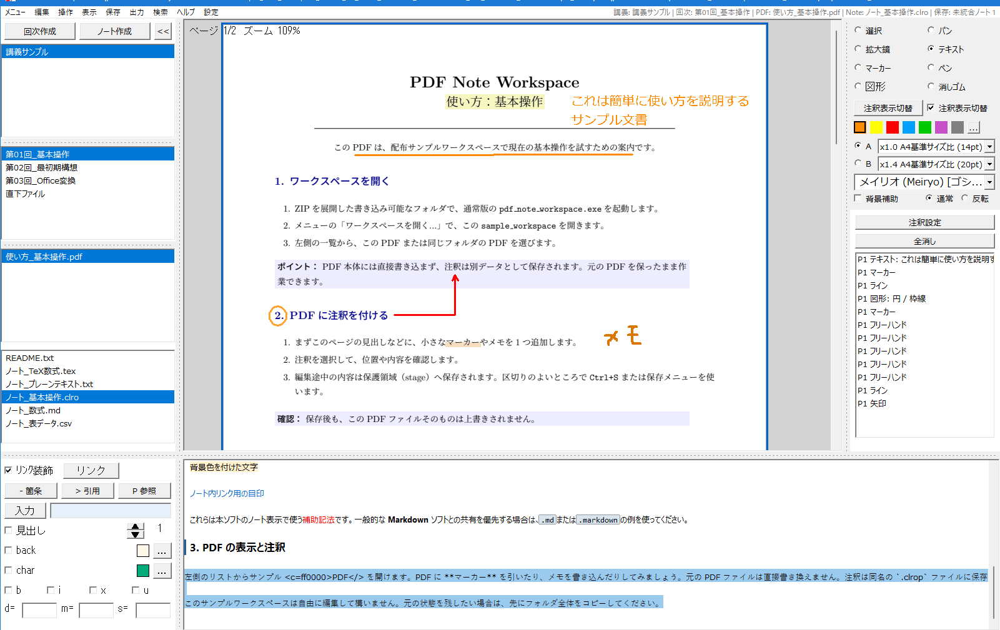

# Using the Application — Open, Record, Save and Share

Follow this guide for a first complete task. Use the [Help Reference](Help_Reference.md) to look up individual operations and settings, and the [Note writing guide](Note_Writing_Guide.md) for syntax examples.

> **About these instructions** — Screen labels, layout and steps may differ slightly depending on your version, settings and display environment. Use the descriptions as a guide and check what appears on screen as you proceed. Before saving, deleting or exporting, check the target files, destination and confirmation details.



Select material and files on the left, then read a PDF and write a note alongside it. PDF overlays and separate written notes can be used together.

## Start working

1. Extract the ZIP to a writable folder, keep EXE, DLLs and settings together, and launch `pdf_note_workspace.exe`. Do not launch from inside the ZIP. [Getting Started](Getting_Started.md) covers setup, updates and Full/Lite choices.
2. Try `sample_workspace/` first if desired. For your own materials, use File to select a writable workspace: this holds documents and saved/recovery data.
3. Use **File > Create > Lecture**, select it, then create a Session. Select existing entries if already present. Generic terminology may show upper/lower items instead.
4. Select the session, then use Ctrl+O to import a PDF or drop it onto either the PDF or note pane. It copies into the session, leaving the original in place. Conflicting names/duplicates are reported before starting; 100 MB or more requires confirmation.
5. Select the PDF in that session's list. Select a note separately to keep writing beside the material.

Folder imports require different drop targets and hierarchy for lectures and sessions. **Temporary Paths** registers external originals without copying; subsequent saving affects those actual files. Read [Files and locations](Help_Reference.md#files-and-locations) before using these routes.

## Make the PDF comfortable to read

Ctrl+E fits the current page, Ctrl+G goes to a page number, and Ctrl+wheel changes zoom. Pan drags the displayed position. View offers reading direction, single/continuous pages and workspace-list visibility.

### Rotate a PDF page

Use **View > Rotate** for the current page or all pages in 90-degree steps. The PDF original is unchanged; viewing angles are stored with the previous position and restored when reopened. Annotations created on a rotated view keep their direction in `.clrop`. PDF output follows Keep page rotation; PNG uses the original orientation. See [PDF view and navigation](Help_Reference.md#pdf-view-and-navigation) for details.

## Choose how to keep your record

| Record | Operation and saved result |
| --- | --- |
| Marks directly over a passage or diagram | Annotation tools; stored in same-named `.clrop` without changing the PDF original |
| Structured writing, headings or equations | Create a note; stored separately in `.clro` or another chosen format |
| Working terms and short reminders | Tools > Workspace memo; one plain-text memo for this workspace |

### Add markers, handwriting or text

1. Choose a marker and color in the annotation pane. Drag over PDF text and release to highlight its lines. Use Free marker over scanned text or diagrams.
2. For handwriting, choose Pen, hold and draw, then release. Lines, arrows and shapes use a drag between endpoints or opposite bounds.
3. Choose Text, click the page and type. Ctrl+Enter or clicking outside confirms. Esc also confirms and ends editing; Ctrl+Z reverses a change.
4. Ctrl+drag moves an annotation. Select it in the annotation list and right-click **Edit** for text, color, width and other properties. Eraser deletes the touched annotation as a unit. Use Edit > Undo for a recent mistake.

The [Annotation reference](Help_Reference.md#annotation-tools-and-colors) covers circles, rectangles, triangles, diamonds, arcs, rotation, underlines, text color, math and note links. It also explains creation defaults versus editing existing items and display versus output behavior.

## Create a note and save your work

Select a session and **Create Note**, then enter a name. Normally choose `.clro`; use `.md` for exchange with Markdown tools or `.txt` for literal text. **Settings > Note > Files** changes the default for new notes, leaving existing formats intact.

Click the note and type, for example:

```text
# Reading notes

- Check the figure on page 3.
- Review the arrow explanation next time.
```

Structured display and editable source share the note pane. The edited line/selection shows source. If Vim is on and the mode is Normal, press `i` to type. In the lower-left input/formatting palette, type text and choose Apply to insert it. To format existing text, select it in the note and leave the palette input empty before applying.

Examples for headings, tables, math, color and links are in the [writing guide](Note_Writing_Guide.md). TXT and CSV do not interpret markup, and CSV is not spreadsheet processing. See [note creation](Help_Reference.md#create-a-note-or-remove-an-empty-note) for empty-note deletion.

Edits are automatically protected as working data. Switching files/sessions/lectures alone does not save original notes or `.clrop`. At a checkpoint or before sharing, press Ctrl+S (**Save > Save Work**) and check the save status. Pre-save copies and verified safe writes update notes and annotations, leaving the PDF unchanged. Normal exit and pre-output processing also save.

A failed save requires reviewing the message and **Save > Review Save Status**. Retain management data, avoid repeated overwrites, and follow [Saving and Recovery](Save_and_Recovery.md) to recover, defer, or rescue into a new file.

## Export the PDF and annotations together

1. Open the annotated PDF.
2. Choose **Output > Quick PDF**.
3. Select a destination and name different from the original. For an existing output file, the application asks whether to overwrite it.
4. Open the completed result and check colors, text, math and orientation before sharing.

Pre-output saving updates the note files and `.clrop` but does not change the original PDF; a save failure stops output. The new annotated PDF can be read by other PDF applications, with further editing depending on that application and annotation type. Retain the original PDF/CLROP pair for continued work.

## Annotations in exported PDFs

The main application writes standard PDF annotations rather than flattening marks into page contents. See [PDF annotation output](Help_Reference.md#pdf-annotation-output) for text-box preferences and the behavior of shapes, math and note links.

## Export one page as PNG or use other formats

Choose **Output > Output Dialog**, select single-page PNG, its page number, annotation inclusion, style and resolution. Use 144 DPI standard, 288 DPI high detail, 72 DPI small, or custom pixels. This creates a separate image. See [Output](Help_Reference.md#output) for selected pages, crops, note TXT/Markdown/HTML, queues and merged PDFs.

## Full and Lite editions

Dropping DOCX/PPTX or images copies their original formats. Request Full's Office conversion, image-to-one-page-PDF conversion or blank PDF creation separately through [conversion tools](Help_Reference.md#convert-materials-or-create-a-blank-pdf). Processing is local and original input files remain. Inspect the result. Lite excludes the Office conversion runtime.

## Read-only viewer

`readonly_viewer.exe` reads multiple PDFs, notes and documents in tabs, including saved same-named `.clrop` beside a PDF. Share the saved pair and keep referenced notes in their expected locations. See [Read-only Viewer](Read_Only_Viewer.md) for tabs, search, diagrams and reopening a session.

## Finding settings

Open **Settings > Settings dialog**, then choose Environment, PDF, Note, Annotation, Save or Export. Save applies while staying open; Save and close applies and exits. Palette and key bindings save separately in their editors. The [Settings reference](Help_Reference.md#settings) explains each page, effects and cancellation scope.

The center guide before opening documents, startup resumption, opening zoom/position and quick-output defaults are configurable. Distinguish temporary viewing changes from saved next-launch defaults.

## If something goes wrong

Check save status, selected PDF/note, operation time and destination, then follow [Troubleshooting](Troubleshooting.md). Help > Checks reports its specific target and operation; it does not guarantee whole-document quality or future saving. See [Checks and help](Help_Reference.md#checks-and-help). Bundled help does not access external sites.
