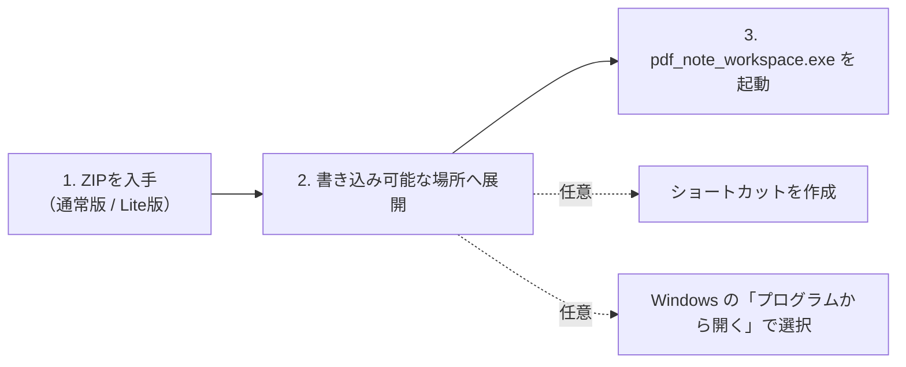

# 導入・更新・アンインストール

同梱リポジトリ版: (ZIP配布物ではここにバージョンが記載されます)

このソフトはインストーラーを使いません。ZIP を展開して使います。管理者権限、ネットワーク接続、既定アプリの自動変更は必要ありません。

この配布物は **Windows x64（64-bit）向け**です。32-bit Windows 向けの配布物はありません。



## 0. GitHub から入手する

GitHub のアカウントや Git の知識は必要ありません。リポジトリの「Releases」（または右側の「Releases」欄にある最新版）を開き、使いたい版の **Assets** から ZIP を 1 つダウンロードします。画面の表示が異なる場合は、「Releases」の一覧から最新版を開いて **Assets** を展開してください。

`Source code (zip)` と `Source code (tar.gz)` は開発用のソースコードです。アプリを使うための ZIP ではないので、選びません。

## 1. 通常版と Lite版を選ぶ

ZIP は通常版と Lite版のどちらか一方を選んで展開します。二つの配布フォルダを混ぜたり、一方から DLL や Office 変換 runtime のフォルダだけを移したりしないでください。

| 版 | 選ぶとき | Office ファイルの扱い |
| --- | --- | --- |
| 通常版 | `.docx` / `.pptx` をアプリ内で PDF にして使いたい | 同梱 LibreOffice でローカル変換できる。変換結果は必ず確認する |
| Lite版 | PDF を既に持っている、または小さい配布物を使いたい | Office-to-PDF 変換は使えない。変換済み PDF を取り込む |

PDF の表示、注釈、ノート、保存・復元は、どちらの版でも同じです。Lite版は起動後のウィンドウ名に `Lite` と表示されます。Microsoft Office やオンライン変換サービスはどちらの版でも使用しません。

通常版で初めて Office 変換を行うときは、Windows のセキュリティ確認のため、変換の開始に時間がかかることがあります。変換はバックグラウンドで行うため、変換中もアプリを使えます。変換の中止、アプリの終了、Windows の終了要求でも LibreOffice の変換プロセスを止めます。原本は変更しません。

## 2. 展開する

1. ZIP ファイルを右クリックし、「すべて展開」を選びます。
2. 展開先は、ユーザー名直下または `ドキュメント` 直下の書き込み可能な新しいフォルダがおすすめです。Windows が「対象のパスが長すぎます」と表示した場合は、`C:\PDFNote` のようなドライブ直下の短い場所も試せます。
3. ZIP の中を直接開いた状態では起動しません。展開後のフォルダから `pdf_note_workspace.exe` を起動します。

通常は `pdf_note_workspace.exe` を使います。閲覧だけなら `readonly_viewer.exe` を使えます。

::: details 初回起動時に「Windows によって PC が保護されました」と表示される場合

初めて `pdf_note_workspace.exe` や `readonly_viewer.exe` を起動したとき、Windows の青い画面（Microsoft Defender SmartScreen）で「Windows によって PC が保護されました」と警告が表示されることがあります。一見すると「実行しない」ボタンしか見えませんが、次の手順で起動できます。

1. メッセージ文中の **「詳細情報」** （下線付きのリンク）をクリックします。
2. 右下に **「実行」** ボタンが表示されるので、**「実行」** をクリックします。

※ コード署名のないZIP配布物のためWindowsが確認画面を表示しますが、外部通信や危険な処理は一切行いません。一度実行を許可すれば、次回からは表示されずに起動できます。

:::

::: details 配布フォルダの中身を移動しない理由

配布フォルダには、実行ファイルのほかに、PDF表示用の `pdfium.dll`、C++ runtime の DLL、通常版では Office 変換用 LibreOffice runtime など、アプリが動作するための部品が入っています。Windows の標準的な DLL 読み込みは実行ファイルのあるフォルダを基準に行われるため、EXE と DLL を別々のフォルダへ移すと起動や PDF 表示に失敗することがあります。Lite版に LibreOffice runtime がないのは仕様です。

通常版は変換runtimeを `lo/`、同梱フォントをその中の `lo/image/Fonts/` に置きます。Lite版はフォントのみを `libreoffice/image/Fonts/` に置くため、フォルダー構成が少し異なります。各版の配置のまま使ってください。

LibreOfficeの内部には深い階層があるため、通常版は短い `lo/` に関連ファイルをまとめ、Windowsで展開先のパスが長くなる問題を抑えています。変換runtimeを持たないLite版は、フォントの由来が分かる `libreoffice/` を使っています。

`pdf_note_workspace_setup.json` は初回起動時のワークスペースと一時外部パスを記録する配布用設定で、実行ファイルのあるフォルダを基準に読み込まれます。これも別の場所へ移したり、名前を変えたりしないでください。旧版の `pdf_workspace_setup.json` がある場合は、初回起動時に新名へ安全にコピーして移行します。旧ファイルは削除しません。個人の PDF、ノート、注釈などの作業データは、配布フォルダとは別のワークスペースに置きます。

ファイルを整理したい場合は、配布フォルダの中身を分類して移動するのではなく、配布フォルダ全体を分かりやすい場所へ置き、ショートカットから起動してください。ショートカットは配布物をコピーするものではなく、元のフォルダにある EXE を直接起動するため、DLL や設定ファイルの場所を保てます。

:::

### 保存場所を自分で決める

配布 ZIP は展開して使います。ファイルとして保存する場所は、次のように分かれます。

| 場所 | 保存するもの |
| --- | --- |
| 展開後のアプリフォルダ | EXE・DLL と `pdf_note_workspace_setup.json`、`readonly_setup.json` などの設定ファイル |
| 利用者が選んだワークスペース | PDF、ノート、`.clrop`。`__pdf_note_workspace__` には自動作業保護、バックアップ、ログ、Office 変換用の一時データを置きます。 |
| 利用者が選んだ出力先／「一時パス」として登録した外部フォルダ | 利用者が明示して保存・出力・外部作業に使うファイル |

AppData、Windows の一時フォルダ、起動元のカレントフォルダを、アプリの暗黙の保存先として使いません。選んだ場所に書き込めないときは、別の場所へ自動で保存せず、失敗を表示します。この説明は永続的なファイル保存の範囲であり、実行中のメモリ使用とは別です。

既存の外部フォルダーをコピーせず使うには、「ファイル → 一時パス → 外部フォルダ追加...」で登録します。アクセス確認後に登録され、次回起動にも残ります。「一時」はWindowsの一時フォルダーではありません。保存・改名・移動は登録先の実ファイルに反映され、登録を外す操作は原本を削除しません。登録に失敗した場合の確認先と再試行手順は[設定などの保存を再試行する](Save_and_Recovery.md#設定などの保存を再試行する)にあります。

## 3. ショートカットを作る（任意）

### デスクトップ

`pdf_note_workspace.exe` を右クリックし、「ショートカットの作成」を選びます。作成先を尋ねられた場合は「はい」を選ぶと、デスクトップに置けます。

ショートカットの作成後は、ショートカットをデスクトップへ移動します。`pdf_note_workspace.exe` 本体や、同じフォルダにある DLL・`pdf_note_workspace_setup.json` は移動しません。

### スタートメニュー

作成したショートカットを右クリックし、「スタートにピン留めする」を選びます。Windows の表示によって項目が見つからない場合は、「その他のオプションを表示」の中を確認してください。

## 4. .clro / .clrop / PDF を開くアプリとして選ぶ（任意）

関連付けは利用者が Windows 上で選びます。このソフトは既定アプリを自動変更しません。

1. 対象ファイルを右クリックし、「プログラムから開く」>「別のプログラムを選択」を開きます。
2. 「この PC で別のアプリを探す」を選び、展開先の実行ファイルを指定します。
3. 必要なときだけ「常にこのアプリを使って開く」を選びます。選ばなければ、その1回だけ開きます。

| 対象 | 選ぶ実行ファイル |
| --- | --- |
| `.clro` | `readonly_viewer.exe` |
| `.clrop` | `readonly_viewer.exe` |
| `.pdf` | `readonly_viewer.exe` |

PDF の既定アプリを変えたくない場合は、PDF には「常にこのアプリを使って開く」を選びません。

## 5. 同梱サンプルを確認する

`sample_workspace` には、初回起動用の第01回にPDFと標準ノートの組があります。第02回_ノート形式には、Markdown、TeX原文、プレーンテキスト、CSV、標準ノートに加え、ノートとPDFを往復するリンク用のPDFと注釈ファイルを同梱しています。第03回の歴史資料と第04回のOffice変換結果には、それぞれ簡潔な `.clro` ノートがあります。

第04回は、ネイティブ図表を含む1ページのPowerPoint変換PDFです。

PDFリンク練習のPDFと同名の `.clrop` は対応するアプリ管理データです。片方だけを移動、改名、削除せず、必ず組で扱ってください。

## 6. 更新する

このソフトは、新しい版の確認、ダウンロード、インストールを自動では行いません。更新するときは、利用者自身で GitHub の Releases から新しい ZIP を入手します。

このソフトは、展開したフォルダにファイルを置いて使うだけの構成です。登録や後処理はなく、更新もファイルを入れ替えるだけで済みます。入れ替え方は、フォルダごとと EXE だけの 2 通りです。

どちらの方法でも、ワークスペースが配布フォルダの外にあることを先に確認します。初回起動時のワークスペースは配布フォルダ内の `sample_workspace` です。ここで作業を続けていた場合は、アプリを終了してから、`__pdf_note_workspace__` を含む `sample_workspace` フォルダごと配布フォルダの外へ移します。移した後は「ファイル → ワークスペースを指定...」でそのフォルダを選びます。

### フォルダごと更新する（標準）

同梱の DLL、Office 変換 runtime、フォント、文書、ライセンスも新しい版にそろいます。どちらの方法にするか迷う場合は、この方法を使います。

1. アプリを終了します。
2. 新しい ZIP を別の新規フォルダへ展開し、`pdf_note_workspace.exe` を起動します。
3. 新しい配布フォルダの設定は初期状態です。「ファイル → ワークスペースを指定...」で使っていたワークスペースを選び、使っていた外部フォルダは「ファイル → 一時パス → 外部フォルダ追加...」で登録し直します。読み取り専用ソフトの「次回開く対象」も登録し直します。
4. 必要なデータを開けることを確認します。

ワークスペースに保存されている設定（パレット、色ストック、配色プリセット、ツールショートカット、テーマ、授業並び順）は、ワークスペースを選び直すとそのまま使えます。以前の配布フォルダは、新しい版で必要なデータを確認できるまで残します。不要になったら、[アンインストールする](#7-アンインストールする)の手順で削除できます。

### EXE だけを置き換える（簡易）

実行ファイルの置き換えだけでも更新できます。配布フォルダ内の設定とワークスペースの指定はそのまま残ります。

1. アプリと読み取り専用ソフトを終了します。
2. 今の `pdf_note_workspace.exe` と `readonly_viewer.exe` の名前を、`pdf_note_workspace.old.exe` のように変えて残します。
3. 新しい ZIP から取り出した同名の 2 ファイルを、配布フォルダへ置きます。
4. 起動して必要なデータを開けることを確認してから、名前を変えた古い EXE を削除します。起動できない場合は、新しい EXE を削除し、古い EXE を元の名前に戻します。

この方法では、同梱の DLL、Office 変換 runtime、フォント、文書、ライセンスは古い版のまま残ります。新しい版でそれらも更新されている場合は、フォルダごと更新すると配布フォルダの中身が新しい版とそろいます。

## 7. アンインストールする

このソフトはインストーラーを使わず、既定アプリ、AppData、Windows の一時フォルダへ設定を書き込みません。アプリを終了した後に保存されていない作業がなければ、配布フォルダを削除するだけでアプリと配布フォルダ内の設定を取り除けます。

1. 「保存 > 保存状態を確認...」と「保存 > 保存できなかった内容…」で、残っている作業がないことを確認します。
2. ワークスペースが配布フォルダの外にあることを確認します。配布フォルダ内の `sample_workspace` で作業していた場合は、残したいデータを先に配布フォルダの外へ移します。
3. アプリ、読み取り専用ソフト、復旧ツールをすべて終了します。
4. 配布フォルダを削除します。ダウンロードした ZIP も不要なら削除します。

配布フォルダを削除しても、次のものは残ります。必要に応じて、利用者自身で確認・削除します。

| 残るもの | 内容と扱い |
| --- | --- |
| 配布フォルダ外のワークスペース | PDF、ノート、`.clrop` と、管理フォルダ `__pdf_note_workspace__`。管理フォルダには自動作業保護、バックアップ、ログ、ワークスペースの設定、Office 変換用の一時データがあります。復旧ツールで「保留して終了」を選んだ変更も `__pdf_note_workspace__` 内に残ります。作業データを残したまま管理データだけを消す場合は、残っている作業と必要なバックアップがないことを確認してから `__pdf_note_workspace__` を削除します。 |
| 「一時パス」で登録した外部フォルダ | 登録先で保存・改名・移動したファイルと、注釈を保存した PDF の `.clrop`。登録先のファイルは利用者のデータとして残します。 |
| 保存・出力で選んだ保存先 | 書き出した PDF やファイル。 |
| 利用者が作ったもの | デスクトップやスタートメニューのショートカット。[4. で選んだ関連付け](#4-clro--clrop--pdf-を開くアプリとして選ぶ任意)は、Windows の「設定 → アプリ → 既定のアプリ」で変更します。 |
| Windows が記録する情報 | プログラムの起動履歴や、ファイル選択画面で最後に開いたフォルダ。Windows が管理する記録であり、このソフトは削除しません。 |

## 8. 配布内容を確認する（任意）

展開フォルダに `checksums.sha256` がある場合は、必要に応じて PowerShell でファイルの SHA-256 を確認できます。

```powershell
Get-FileHash .\pdf_note_workspace.exe -Algorithm SHA256
```

表示された値を `checksums.sha256` の同じファイル名の行と比較します。値が一致しない場合は起動せず、ZIP を再取得して展開し直してください。

## 困ったとき

問題が起きた原本とワークスペースの `__pdf_note_workspace__` フォルダを残し、表示されたメッセージと失敗した操作を控えます。保存できない、ファイルが開けない、画面が表示されない、Office 変換でパスが長すぎるときの確認は、[困ったときの対処](Troubleshooting.md#最初に行うこと)にあります。
