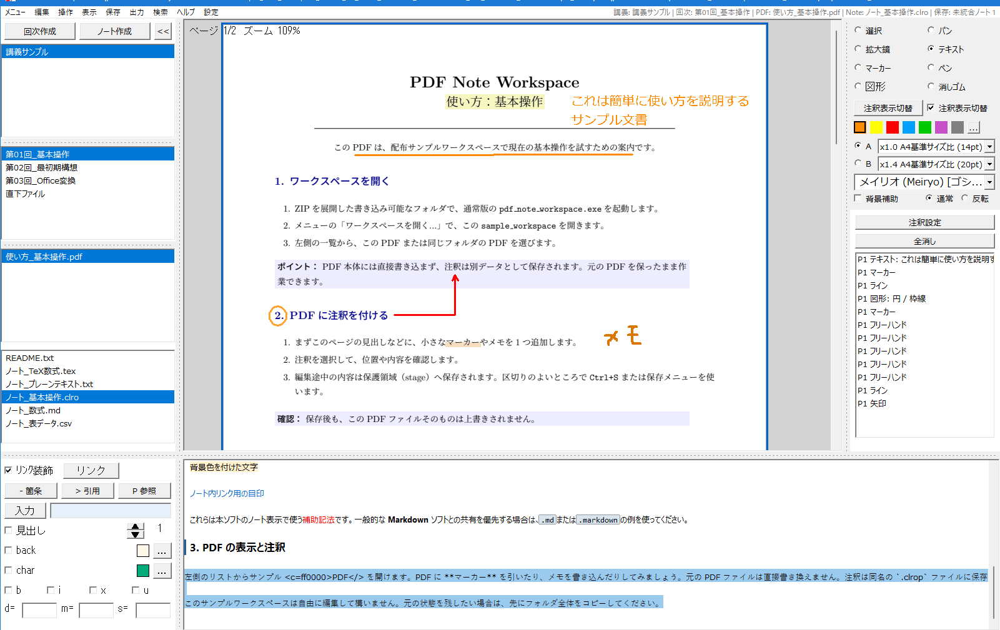

# 使い方

同梱リポジトリ版: (ZIP配布物ではここにバージョンが記載されます)

この文書では、PDFを開き、記録を残し、保存・共有するまでの基本操作を案内します。初めて使う場合は、まず「最初にすること」を順に行ってください。その後は、作業中に必要になった項目を読めば十分です。迷ったときは、保存せずに画面の表示とファイル名を確認してください。

*（PDF閲覧・非破壊注釈・手書きメモ・ノート編集を1画面で行えるメイン操作画面）*

## 最初にすること

1. 配布物を、書き込み可能なフォルダへ展開します。ZIP の中から直接起動しないでください。展開、ショートカット、関連付け、更新の詳細は [Getting_Started.md](Getting_Started.md) を参照してください。
2. 通常は `pdf_note_workspace.exe` を起動します。PDF やノートを閲覧だけしたい場合は、`readonly_viewer.exe` を使えます。
3. 初回確認には `sample_workspace/` を使えます。自分のPDFやノートを扱う場合は、配布フォルダとは別のワークスペースを開き、読みたいPDFを選びます。
4. 資料を読みながら記録したい場合は、「ノート作成」でノートを作るか、PDF上へマーカー・手書き・文字・図形の注釈を加えます。

`readonly_viewer.exe` は、複数のPDF・ノート・文書をタブで読み比べるための閲覧専用ソフトです。同じフォルダーの同名 `.clrop` があれば、注釈もPDFへ重ねて表示します。[読み取り専用ビューアの紹介と使い方](Read_Only_Viewer.md) を参照してください。注釈やノートの編集にはメインソフトを使います。

## 記録の残し方を選ぶ

PDFを読みながら記録する方法には、似て見えても保存先と目的が異なるものがあります。目的に合わせて、次の違いを確認してください。

| 種類 | 何をするか | このアプリでの扱い |
| --- | --- | --- |
| **PDFを編集する** | PDFの本文、画像、ページなど、資料そのものを変更します。 | 注釈作業では行いません。元のPDFを保ちます。 |
| **PDFへ注釈を付ける**（annotation） | PDFには注釈（Annotation）を保持する仕組みがあり、マーカー、手書き、テキスト、図形などの記録をPDFに重ねられます。 | 閲覧中はPDFの上に表示し、資料を読みながら記録できます。 |
| **別ファイル注釈** | 注釈をPDF本体とは別のデータとして保存します。 | このアプリの注釈は、同名の `.clrop` ファイルに保存します。PDFと `.clrop` を組として扱うため、注釈を再表示・編集できます。 |

PDFと注釈を1つの新しいPDFファイルにまとめて出力できます。元のPDFは変更しません。PDFと `.clrop` の対応や移動時の注意は [File_Formats.md](File_Formats.md) を参照してください。

文字注釈ツールで既存のテキストボックスをクリックすると、再編集できます。Box内の上下端には再編集に入らない範囲があり、上下それぞれBox高さの10%、ただし対象フォントの1行の高さの31%を上限とします。再編集できる位置では、入力候補のキャレットをBox内に表示します。

文字サイズのA/Bはプリセットです。再編集中も、AまたはBをクリックするとそのプリセットを適用します。選択中のA/Bをもう一度クリックして戻すこともできます。`Ctrl++` / `Ctrl+-` は対象Boxのサイズと使用中のサイズ表示を変更し、保存したA/Bの値と未使用側の表示は保持します。Boxの選択やテーマの適用だけでは、文字サイズを変更しません。

注釈ツール欄が狭く、図形などの設定が下まで収まらないときは、欄内のホイール操作や縦スクロールバーで下の設定へ移動できます。閉じた選択欄の上でも、ホイールはツール欄をスクロールします。キーボードで設定項目へ移動した場合も、その項目が見える位置を表示します。

## ノートを作る

「ノート作成」で新しいノートを作れます。既定の拡張子は `.clro` です。

設定の「ノート」→「ファイル」で、新規ノートの既定形式（`.clro` / `.md` / `.txt` / `.csv`）を保存できます。作成ボタンの右クリックによる形式選択も同じ既定値を変更します。既存ファイルの形式は変えません。

回次を開き、ノートを開かずに文字を入力した場合も、この既定形式で新しいノートを作成します。

空の `.clro` は、ファイル欄の右クリックメニューから削除できます。入力した文字をすべて消した場合は、空の状態で保存を完了してから削除してください。作成直後の空ノートは、そのまま削除できます。BOMだけのファイルも本文は空として扱いますが、空白や改行などの本文があるファイルは保持します。

- `.clro` は本ソフトで作成・管理する標準ノートです。
- `.md` / `.markdown` は他の Markdown ツールとの互換性を優先したい場合に選べます。
- `.txt` / `.csv` は書式を解釈しないプレーンテキストです。`.csv` の表計算用の特別な処理は行いません。

詳しくは [File_Formats.md](File_Formats.md) を参照してください。

ファイル名は、内容が分かる短い名前にします。既にある `.md` や `.txt` を開いて編集しても、アプリが勝手に `.clro` に変更することはありません。

## 編集内容を保存する

編集途中の内容は、内部で自動保護されます。ファイル・回次・授業の切替では原本を書き換えずに保護済みの状態を引き継ぎます。`Ctrl+S`、保存メニュー、通常の終了、または出力の直前には、原本を上書きする前に保存前の控えを作り、安全な書込みを確認してから原本へ保存します。

保存前にはバックアップが作られます。保存中にエラーが出た場合は、何度も上書きしようとせず、表示内容を控えてから [Troubleshooting.md](Troubleshooting.md) を確認してください。保存と復元の仕組みは [Save_and_Recovery.md](Save_and_Recovery.md) にまとめています。

## 設定の場所

設定は、左側の「環境・PDF・ノート・注釈・保存・出力」から操作場所に合わせて選びます。ノート欄や注釈欄の設定ボタンも同じ画面の該当項目を開きます。

- 環境: 画面・共通操作、色・パレット、ファイル一覧、診断・設定管理。
- PDF: 表示・操作。
- ノート: 文字・表示、入力・キー操作、マークアップ、ファイル。追加許可拡張子は「ファイル」で確認・編集します。PDF・Office・実行ファイルなどの制限は、このリストで解除できません。
- 注釈: ツール・表示、入力・パレットへの近道。
- 保存: 自動保存による作業データの保護と、バックアップ・復元への入口。
- 出力: 簡易PDF出力と簡易ノート出力の既定値。今回の出力先・範囲・予約などは出力ダイアログで指定します。出力ダイアログの簡易出力設定ボタンからも同じ画面を開けます。

色を1色選ぶ専用画面では、確定した色だけを呼び出し元へ返し、パレットは保存しません。

項目を切り替えても編集中の値を保ちます。「このページの編集を戻す」は表示中の小項目だけを戻します。「設定を保存」は変更を保存して画面を開いたままにし、「保存して閉じる」は保存後に閉じます。未保存の編集がある状態で閉じると、保存・破棄・編集を続ける選択が出ます。パレットやキー割当など、個別に保存される変更はこの取消の対象になりません。

## 資料を開く前の中央案内

PDFもノートも開いていないときは、PDF表示欄に使い方の番号付きリストと主な操作・ショートカットを中央に表示します。PDFやノートを開くと案内を隠します。

設定の「環境」→「画面・共通操作」で、「使い方＋ショートカット」「ショートカットのみ」「表示しない」を選べます。初期値は両方の表示です。項目が長いときは、案内のホイール・スクロールバー・Page Up / Page Downで続きを読めます。

案内下部には、「ショートカットのみ」「表示しない」へ変更できることと設定の場所を示します。この説明は案内をスクロールしても下部に表示します。

注釈の個別キーは現在の割り当てから表示します。「注釈」→「入力」でキーを編集して保存すると、中央案内も更新します。注釈カテゴリ・詳細種・パレット色の固定操作、保存・検索・PDF倍率などの操作も確認できます。

## 起動・PDF表示・出力の既定値

設定の「環境」→「画面・共通操作」では、「起動時に前回の作業を再開する」をOFFにすると、次回はワークスペースだけを開きます。前回の記録は消しません。起動時にファイルを明示指定した場合は、そのファイルを開きます。

「PDF」→「表示・操作」の「PDFを開いたときの表示」では、従来の自動調整、前回の位置・倍率、先頭ページの幅、先頭ページ全体から選べます。初期値は従来の動作です。古い位置記録に倍率がない場合は自動調整します。

CLROをMarkdownへ出力するときの全角記法の半角化は、出力ダイアログで設定します。初期ONです。「この選択を次回の既定にする」を押すと、次回起動後にも使う既定値を保存できます。登録しない変更は、再起動後の既定値を変えません。簡易ノート出力はTXTのため、この設定は使いません。

## PDF以外の資料を取り込む

ファイルをPDF欄またはノート欄へドロップすると、確認なしで現在の回次へコピーして取り込みます。どちらの欄も同じ扱いで、取り込んだファイルは形式別に分類します。

フォルダーは授業欄へドロップすると新しい授業、回次欄へドロップすると選択中の授業の新しい回次として、名前と階層を保ってコピーします。授業用のフォルダーは、その直下に回次フォルダーがある構成で用意してください。資料が直接入ったフォルダーは回次欄へドロップします。

元のファイル・フォルダーは変更しません。同名の保存先、重複や範囲の重なり、ファイルとフォルダーの混在、ドロップ先の誤りがあれば、一括取り込み全体を開始せずに通知します。既存データへの上書き・統合や自動での別名取り込みはしません。取り込み中に読み書きに失敗した場合は処理を止め、完了した項目を保持して結果を表示します。

取り込み・コピーするファイルの合計が100 MB以上の場合は、開始前に「続ける／やめる」を確認します。100 MB以上・500 MB以上・1 GB以上の3段階で案内し、フォルダー内のファイルも合算します。既定は「やめる」で、閉じる・Esc・既定のEnterでも開始しません。MBは1,000,000バイト、GBは1,000,000,000バイトです。

Officeファイル（`.docx` / `.pptx`）も元の形式で取り込み、ドロップ時にはPDF変換しません。通常版では回次の右クリック「OfficeファイルをPDFに変換」で、PDF未作成のOfficeファイルを後からまとめて変換できます。再起動後も取り込んだ元ファイルは残ります。外部ファイルを選んで直接変換する場合は、メニューの「LibreOfficeでDOCX/PPTXをPDFに変換（試験的）...」を使います。

また、画像ファイル（`.png` / `.jpg` / `.jpeg`）も 1 ページの PDF へ変換してワークスペースへ取り込めます。ドロップした画像は元の形式で取り込むので、PDF一覧の右クリックメニューから「画像をPDFに変換（1ページPDF作成）」を選びます。元の画像ファイルは変更せず、画像の解像度・サイズに基づき 1 ページの PDF を生成します。

変換は同梱 LibreOffice やローカルライブラリを使う完全なローカル処理です。Microsoft Office や外部オンライン変換サービスには接続しません。最初の変換では Windows のセキュリティ確認のため開始まで時間がかかることがありますが、変換はバックグラウンドで進むため、その間もアプリを操作できます。中止・アプリ終了・Windows の終了要求では、変換用の LibreOffice プロセスも停止します。元の DOCX/PPTX や画像は変更せず、変換結果の PDF を確認してから使ってください。Office 文書のフォント、図形、数式などによっては、見た目が元の Office 文書と完全には一致しないことがあります。

Lite版はウィンドウ名に `Lite` と表示され、Office-to-PDF 変換 runtime を含みません。DOCX/PPTXをドロップすると元の形式でコピーして取り込みます。PDFへの変換には通常版を使用するか、別途PDFを用意してください。

## PDFページの向きを変える

「表示 → 回転」で、現在のページ、または全ページを右90度・左90度に回転したり、元の向きへ戻したりできます。横向きなどで配布されたPDF全体を読みやすくする場合は「全ページ」を使います。全ページの回転は各ページへ同じ回転量を加えるため、個別に調整済みのページとの向きの差も保ちます。表示の向きは一時的で、PDF原本や次回起動の設定には保存しません。回転した画面で新しく入力する文字・数式・図形は画面に対して正立し、その後は紙面に固定されて一緒に回ります。注釈自身の位置と向きは `.clrop` に保存します。

PDF出力の「ページの回転を維持」は初期ONで、ページごとの表示角を出力設定の追加時に記憶し、予約を並べ替えて結合しても保持します。OFFでは元のPDFの向きで出力します。幅・高さは選んだ出力方向を基準に指定します。簡単PDFも初期ONです。このチェックを変更して「簡単PDFに設定」を押すと、簡単PDFで使うON/OFFを保存できます。角度自体は保存せず、出力する時点の表示角を使います。PNGは元のPDFの向きで出力します。

## PDFの1ページをPNG画像として出力する

メニューの「出力」から「単ページPNG」を選び、ページ番号、注釈を含めるか、画像スタイルを指定して保存します。PNG は可逆形式で、元PDFは変更しません。

- `標準 (144 DPI)` は画面共有・ノート貼り付け向けの既定値です。
- `高精細 (288 DPI)` は細かい文字や印刷前の確認向けです。ファイルサイズと処理時間は増えます。
- `簡易 (72 DPI)` は容量を小さくしたい場合に使います。
- `指定` では縦横の画素数を入力できます。縦横比は維持され、最大 3,200 万画素までです。上限の案内が出た場合は、画像サイズを小さくしてください。

注釈を含める場合は、PDF向けの見た目と閲覧画面に近い見た目を選べます。出力後は、特に細い線、半透明マーカー、数式、色付き文字が意図どおりかを画像で確認してください。保護設定のあるPDFは、権利者の指定を尊重してページ画像を出力できない場合があります。

Markdownや `.clro` の対応するMermaid図は、読み取り専用ビューアの読書表示で文書内に表示されます。`Ctrl+4` で図の一覧、`Ctrl+2` で原文へ切り替えられます。対応しない構文は原文で確認できます。図の表示はローカルで行い、文書ファイルを変更・保存しません。

## PDFと注釈を1つのPDFファイルにまとめる

次の手順で、注釈をPDF内に含む1つのPDFファイルを作成します。

1. 注釈を付けた PDF を開きます。
2. メニューバーの **出力** から **簡単PDF...** を選びます。
3. 出力先とファイル名を指定して、出力します。

出力前に、未保存のノートと注釈を保存します。この保存でノートファイルや `.clrop` は更新されますが、元のPDFは変更しません。保存に失敗した場合は、出力を行いません。

出力先には、元のPDFとは別のファイルを指定してください。同名の出力ファイルが既にある場合は、上書きするか確認します。

::: details 出力PDFの注釈形式と、後で編集するときの注意

### 出力PDFでは書き込みをどう保存するか

メインソフトの統合出力では、PDFと別ファイル注釈を一つの新しいPDFにまとめます。書き込みはPDFの標準注釈として保存するため、出力後も注釈として扱えます。

焼き込みとは、書き込みをPDFのページの内容にして、個別の注釈としては扱えなくする方式です。メインソフトの出力は焼き込みではありません。対応するPDF閲覧・編集ソフトでは、注釈一覧から確認したり、注釈を削除・移動したりできます。本文や形状をどこまで再編集できるかは、開くソフトと注釈の種類によります。

| 本ソフトの書き込み | 出力PDFの注釈 |
| --- | --- |
| 文字マーカー | `Highlight`。文字の範囲と色を保存します。 |
| 手書き・フリーマーカー・直線・矢印・波線 | `Ink`。線の点列と見た目を保存します。矢印や波線も手書き注釈として扱います。 |
| 文字欄 | 既定は `FreeText`。入力した本文と表示用の描画を保存します。フォントなどの条件により表示を保持できない場合は `Stamp` にします。 |
| 長方形・正方形 | `Square`。円・楕円は `Circle`。 |
| 数式・その他の図形・ノートへのリンクマーカー | 見た目を保持した `Stamp`。数式の式やリンクIDは注釈の本文に残しますが、PDF上でノートへ移動するリンクにはなりません。 |

出力ダイアログの「文字欄はFreeTextを優先」を外すと、文字欄も画像を持つ `Stamp` 注釈になります。この選択は文字欄だけに適用され、焼き込みへ切り替える設定ではありません。PDF注釈と焼き込みを選ぶ機能はありません。

閲覧専用ビューアは、PDFと `.clrop` を読み返すために使います。PDFと注釈を1つのPDFファイルにまとめるときは、メインソフトから出力してください。

通常の保存では、引き続き元のPDFと別の `.clrop` に書き込みを保存します。出力PDFの注釈を本ソフトの編集データへ取り込む機能はありません。後で本ソフトで編集するため、元のPDFと `.clrop` も保管してください。

注釈の作成に失敗した場合は、書き込みが欠けた出力ファイルを作らずに処理を中止します。

PNG出力にはPDF本体に含まれる注釈も表示されます。「注釈を含む」は、本ソフトの別ファイル注釈を追加するかどうかの設定であり、PDF本体の注釈を消す設定ではありません。

:::

## 困ったとき

アプリ内の「ヘルプ」では、カテゴリを選んで必要な説明を確認できます。「ヘルプ > 独自拡張子 (.clro)」はノート拡張子の説明を直接開きます。

保存失敗、復元、開けないファイルなどは [Troubleshooting.md](Troubleshooting.md) を参照してください。

ヘルプはアプリに同梱されており、外部サイトへ接続しません。
