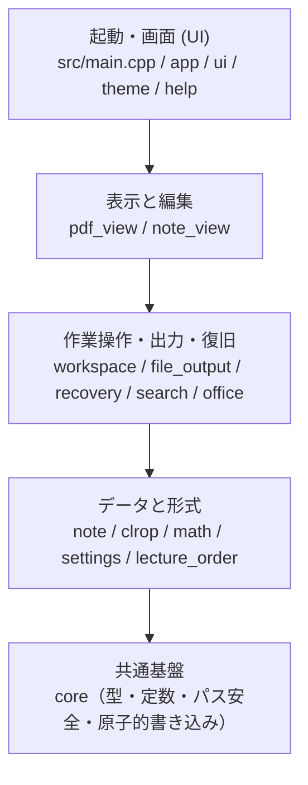

# 構成レイヤー

## 1. 概要 (Overview)

PDF Note Workspace は、Win32 API と C++17 で実装された、ローカルだけで動作し原本を壊さないデスクトップアプリケーションです。
Qt・Electron・.NET などのアプリケーションフレームワークは使わず、Windows API と GDI で画面を描画します。PDF の描画には PDFium、Markdown の解析には md4c を使います。

## 2. 階層構造 (Layer Hierarchy)

ソースは `src/` の下にディレクトリ単位で分かれています。依存は原則として上の層から下の層へ向けます。

### 層と役割

| 層 | 主なディレクトリ | 役割 |
| --- | --- | --- |
| 起動・画面 | `src/main.cpp`、`src/app/`、`src/ui/`、`src/theme/`、`src/help/` | `WinMain`、起動時の多重起動確認と前回状態の復元、メインウィンドウとメッセージ処理、レイアウト（左右分割）、ダイアログ、ショートカット、ライト/ダークのテーマ、ヘルプ |
| 表示と編集 | `src/pdf_view/`、`src/note_view/` | PDFium による PDF ページの描画・拡大縮小・スクロール、注釈の描画と選択・移動・編集、ノート画面の入力と表示、数式プレビュー |
| 作業操作・出力・復旧 | `src/workspace/`、`src/file_output/`、`src/recovery/`、`src/search/`、`src/office/` | ワークスペース内のファイル操作（取り込み・移動・名前変更）、stage の管理、注釈付き PDF などの出力、異常終了後の復旧、ノート検索、Office 文書の PDF 変換の準備 |
| データと形式 | `src/note/`、`src/clrop/`、`src/math/`、`src/settings/`、`src/lecture_order/` | ノートのモデル・解析（md4c）・編集履歴・描画準備、注釈ファイル `.clrop`（JSON）の読み書き、数式の解析と描画、設定とパレット、講義の優先順位による並べ替え |
| 共通基盤 | `src/core/` | 注釈の型とコマンド、定数・コマンド ID、パスの安全確認、原子的書き込み（`atomic_write.h`）、ハッシュ、文字コード、多言語文字列 |

このほか、`src/diagnostics/` は書き込み確認や上限付きログなどの診断、`src/bridge/` は PDF 画面とノート画面の間の受け渡し、`src/features/` は自動検査と一時パスの処理、`src/resources/` はアイコンとマニフェストを持ちます。`src/readonly_viewer/` と `src/readonly_viewer_next/` は、本体とは別の exe としてビルドする閲覧専用ビューアーです。

### 主な仕組み

- **stage**：編集途中の状態をワークスペース内の stage 領域へ自動で保存し、次回起動時の復元やロールバックに使います。実装は `src/file_output/file_output_stage.cpp`、`src/core/annot_stage_replay.h`、`src/recovery/stage_recovery.h` などに分かれています。
- **元に戻す / やり直し**：履歴には上限があります。注釈は 30 回分、注釈内テキストの編集は 100 回分（`src/pdf_view/navigation.cppinc`）、ノートは 4096 件分（`src/note/note_history.cpp`）です。
- **原子的書き込み**：`atomic_write::AtomicWriteUtf8` / `AtomicWriteBytes` は、一時ファイルへ書き終えてから置き換えます。途中で失敗しても元のファイルを損ないません。書き込み先のパスは各呼び出し元で検証します。

### 現状の例外

上の図は目指す依存の向きです。現状のコードには、下の層から上の層を参照している箇所が残っています。

- `src/core/app_core.cpp` は、アプリ全体の状態を持つため、`ui/`・`workspace/`・`app/`・`settings/`・`theme/` を参照しています。
- `src/core/annot_types.h` と `src/core/app_core.h` は `workspace/session_order.h` を参照しています。
- `src/workspace/`・`src/file_output/`・`src/pdf_view/` は、通知やダイアログのために `src/ui/` の一部を参照しています。

新しいコードでは、これらの例外を増やさないようにします。

## 3. スレッドと制御フロー (Threading & Control Flow)

- **メイン UI スレッド**：
  - メッセージループ、`WM_PAINT` の描画、利用者の入力への応答は、メイン UI スレッドで処理します。
  - メイン UI スレッドでは、完了を待って止まる処理（`std::future::get()` や、デッドロックを招くロック）を行いません。
- **バックグラウンドスレッド**：
  - PDF ページの描画（`src/pdf_view/layout_cache.cppinc`）や stage の統合（`src/file_output/file_output_stage.cpp`）などは、別スレッドで処理し、結果をメイン UI スレッドへ渡します。
- **別プロセス**：
  - ノート検索は検索用の子プロセスで行います（`src/search/search_process.cpp`）。アプリを閉じると子プロセスも終了します。
  - DOCX/PPTX から PDF への変換（通常版）は、同梱の LibreOffice を別プロセスで実行します（`src/workspace/workspace_actions.cpp`）。
  - 異常終了後の復旧は、独立した復旧プロセスで行うことがあります（`src/recovery/standalone_recovery.cpp`）。
  - いずれもローカルで完結し、外部通信は発生しません。

## 4. モジュール間参照ルール

- 下の層（`src/core/`、`src/note/`、`src/clrop/` など）から、画面の層（`src/ui/`、`src/app/`）への参照を新しく追加しません。
- ファイルの保存・置き換えは、`src/core/atomic_write.h` の原子的書き込みを使います。
