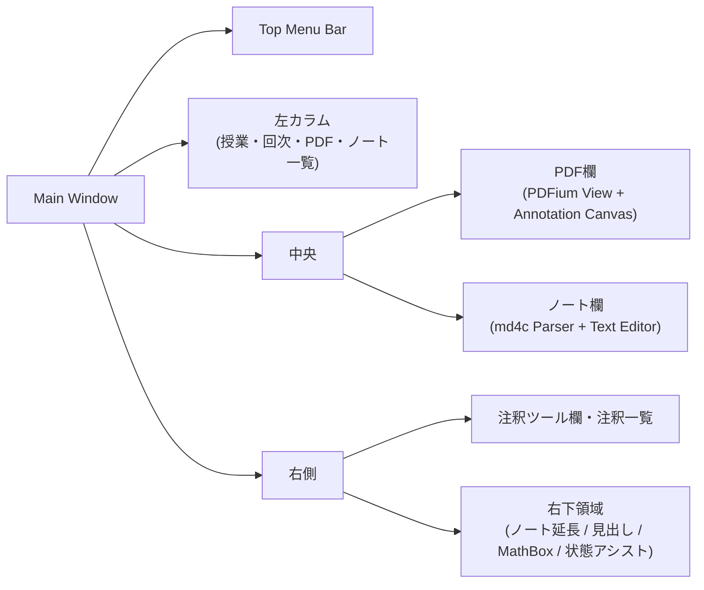

# 画面と操作の考え方

---

## 1. UI_TERMINOLOGY_INDEX

```yaml
[UI_ELEMENT: WORKSPACE]
CONCEPT: PDF、注釈データ、ノート、設定を保持する作業用フォルダ構造
EVIDENCE: docs/ja/Using_the_App.md

[UI_ELEMENT: LEFT_COLUMN]
CONCEPT: 「左カラム」。授業・回次・PDF・ノートの一覧を縦に並べ、資料を選ぶ領域。「表示」から表示・非表示を切り替える
EVIDENCE: docs/ja/Help_Reference.md

[UI_ELEMENT: PDF_PANE]
CONCEPT: 「PDF欄」。PDF本体の表示、注釈描画、閲覧を行う中央の領域
EVIDENCE: docs/ja/Using_the_App.md

[UI_ELEMENT: NOTE_PANE]
CONCEPT: 「ノート欄」。テキスト/Markdownノートの作成・編集を行う中央の領域。PDF欄の下に置き、配置設定（workspace.json の notePlacement）で上下を入れ替えられる
EVIDENCE: docs/ja/Using_the_App.md

[UI_ELEMENT: ANNOTATION_TOOLBAR]
CONCEPT: 右側の注釈ツール欄。ペン、マーカー、テキスト入力、図形描画などのモード切り替え部と、作成済み注釈の一覧
EVIDENCE: docs/ja/Help_Reference.md

[UI_ELEMENT: BOTTOM_RIGHT_AREA]
CONCEPT: 「右下領域」。ノートテキストの延長、見出し一覧、MathBox入力、状態アシストを「表示 → 右下領域」で切り替える
EVIDENCE: docs/ja/Help_Reference.md
```

「stage」は保存の内部作業保護（`__pdf_note_workspace__/__unsaved__/`）を指す語であり、画面の領域名には使わない。

### 画面レイアウト階層構造 (UI Layout Structure)



<ui_layout_hierarchy>
  <component id="main_window" type="root_container">
    <children>
      <child id="top_menu_bar" type="menu" position="top" />
      <child id="left_column" type="list_panel" position="left" role="lecture_session_file_lists" />
      <child id="center" type="split_view" position="center">
        <panel id="pdf_pane" position="top" role="pdf_render_and_draw" />
        <panel id="note_pane" position="bottom" role="markdown_note_edit" note="notePlacement で上下を入れ替え可能" />
      </child>
      <child id="right_column" type="split_view" position="right">
        <panel id="annotation_toolbar" position="top" role="annotation_tool_selection_and_list" />
        <panel id="bottom_right_area" position="bottom" role="note_extension_headings_mathbox_assist" />
      </child>
    </children>
  </component>
</ui_layout_hierarchy>

---

## 2. OPERATION_LOCATION_GUIDE

```xml
<operation_mapping>
  <action type="file_management">メニューバーの「ファイル」 / 左カラムの一覧の右クリック</action>
  <action type="annotation_tool_selection">右側の注釈ツール欄</action>
  <action type="save_and_recovery">メニューバーの「保存」メニュー（作業保存・保存状態を確認・保存済みファイルのバックアップ）</action>
  <evidence_path>docs/ja/Using_the_App.md</evidence_path>
</operation_mapping>
```
